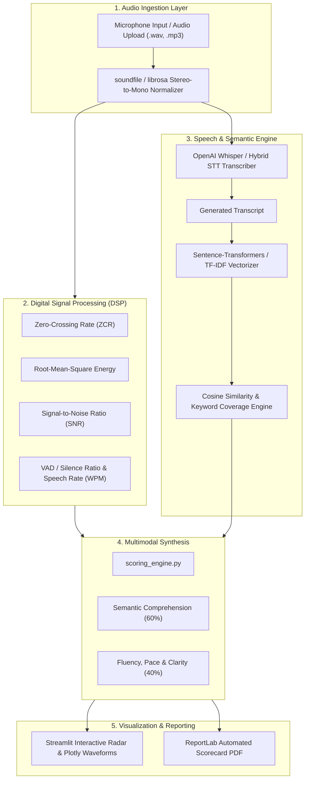

# VBCUA — Voice-Based Concept Understanding Analyser

[](https://www.python.org/)
[](https://streamlit.io/)
[](https://scikit-learn.org/)
[](https://www.reportlab.com/)
[](https://plotly.com/)
[](https://opensource.org/licenses/MIT)

**VBCUA** is an automated multimodal evaluation system that grades a student's verbal explanation of technical concepts. The system combines digital signal processing (DSP) for acoustic fluency metrics with natural language processing (NLP) for semantic conceptual accuracy, generating audit-grade PDF evaluation scorecards.

---

## 🏛️ System Architecture



---

## 🔬 Core Evaluation Dimensions

| Dimension | Metric / Algorithm | Target Ideal Range | Impact |
| :--- | :--- | :--- | :--- |
| **Semantic Accuracy** | Sentence-Transformers (`all-MiniLM-L6-v2`) / TF-IDF Cosine Similarity | $\ge 0.75$ | Validates that the core technical definitions are understood and explained. |
| **Keyword Coverage** | Tokenized intersection with domain ontology keyterms | $\ge 80\%$ | Ensures critical domain vocabulary (e.g., cardinality, normalization, bias-variance) is used. |
| **Speech Rate** | Words Per Minute (WPM) computed over active speech intervals | $120 - 150 \text{ WPM}$ | Measures nervous rushing or excessive hesitation. |
| **Fluency & Pauses** | Silence duration ratio over total audio duration | $15\% - 25\%$ | Identifies long cognitive pauses and unorganized thought delivery. |
| **Signal Clarity** | Decibel SNR estimation | $\ge 18 \text{ dB}$ | Ensures acoustic intelligibility and background noise suppression. |

---

## 📂 Repository Structure

```text
vbcua-concept-analyser/
├── app.py                  # Streamlit dashboard & interactive evaluation UI
├── audio_utils.py          # DSP audio feature extraction (WPM, silence, SNR, ZCR)
├── speech_to_text.py       # OpenAI Whisper transcription with offline mock fallback
├── semantic_eval.py        # Sentence transformer semantic similarity & TF-IDF
├── scoring_engine.py       # Weighted aggregation scoring matrix
├── report_generator.py     # PDF generation engine using ReportLab Platypus
├── generate_voice.py       # Helper utility generating sample reference audio
├── verify_logic.py         # End-to-end integration and sanity test script
└── requirements.txt        # Python dependency specifications
```

---

## 🚀 Installation & Local Execution

### Prerequisites
- Python 3.10+
- FFmpeg (for system-wide audio format conversions)

### 1. Clone & Setup Virtual Environment
```bash
git clone https://github.com/ak-bharadwaj/vbcua-concept-analyser.git
cd vbcua-concept-analyser

python -m venv venv
source venv/bin/activate  # On Windows: .\venv\Scripts\activate

pip install -r requirements.txt
```

### 2. Configure Environment (Optional)
If using live OpenAI Whisper for transcription, create a `.env` file:
```env
OPENAI_API_KEY=sk-your-openai-api-key
```
*(Note: If no API key is provided, the system gracefully falls back to an offline simulated speech transcription pipeline).*

### 3. Run Verification Tests
```bash
python verify_logic.py
```

### 4. Launch Streamlit Application
```bash
streamlit run app.py
```
Open [http://localhost:8501](http://localhost:8501) in your browser.
